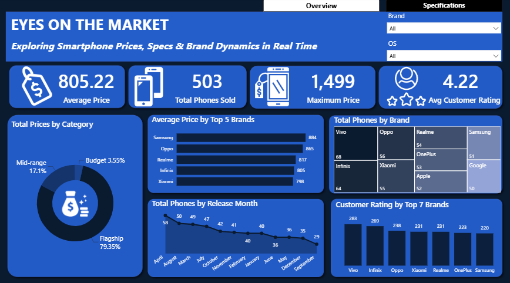
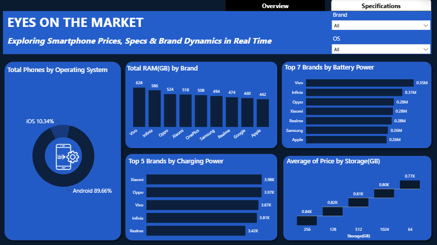

# Blueprint of the Modern Smartphone: Phone Prices Dashboard
### How RAM, Storage, Battery & Brand Dynamics Shape Market Value

#### About the Project

**Eyes on the Market** is an interactive Microsoft Power BI dashboard, which is part of a larger project titled **Blueprint of the Modern Smartphone**, designed using a combination of analytical tools and softwares to explore smartphone prices, technical specifications, customer ratings and brand presence across phones released in 2025.

The report has two pages. The **Overview** page looks at price levels, brand presence, release months and customer ratings. The **Specifications** page looks at operating systems, RAM, battery, charging power and storage.

The second phase of the project includes a machine learning as part of a predictive analytics framework built in Python, that tests whether technical specifications can predict phone price. The final phase of the project provides useful data-based recommendations, fulfiling the prescriptive objectives.

The project is an analytical and data visualisation exercise intended to demonstrate how product data can be transformed into meaningful, interactive insights. The underlying data is a simulated dataset and as such, should be interpreted in the context of the project rather than as real market results.

#### Project Objectives

The dashboard was created to explore four main questions:

1. Which brands show the strongest presence across the market, based on release volumes and categories?
2. How does pricing vary across brands, and do premium devices offer proportional value?
3. How do technical specifications such as battery, storage, camera quality and RAM compare across key brands?
4. How do individual specifications influence pricing, and what market trends emerge?

#### Dashboard Preview

| Overview Page | Specifications Page |
|---|---|
|  |  |

#### Dashboard Components

##### 1. Overview KPIs

The Overview page opens with four key performance indicators (KPIs):

- **Average Price:** 805.22
- **Total Phones:** 503
- **Maximum Price:** 1,499
- **Avg Customer Rating:** 4.22

##### 2. Total Prices by Category

The donut chart shows each price category's share of the total price value:

- Flagship — 79.35%
- Mid-range — 17.10%
- Budget — 3.55%

##### 3. Average Price by Top 5 Brands

The bar chart ranks the five brands with the highest average price:

- Samsung — 884
- Oppo — 865
- Realme — 817
- Infinix — 805
- Xiaomi — 798

##### 4. Total Phones by Brand

The treemap compares the number of phones across the nine brands: Vivo, Infinix, Oppo, Xiaomi, Realme, OnePlus, Apple, Samsung and Google. Vivo is shown as the largest brand.

##### 5. Total Phones by Release Month

The line chart tracks the number of phones released in each month of the year. April has the most releases and September has the fewest.

##### 6. Customer Rating by Top 7 Brands

The column chart shows the total customer rating for the seven brands with the highest totals:

- Vivo — 283
- Infinix — 269
- Oppo — 238
- Xiaomi — 231
- Realme — 231
- OnePlus — 223
- Samsung — 220

##### 7. Total Phones by Operating System

The donut chart on the Specifications page shows the operating system split:

- Android — 89.66%
- iOS — 10.34%

##### 8. Total RAM (GB) by Brand

The column chart shows total RAM across each brand's phones:

- Vivo — 628
- Infinix — 586
- Oppo — 524
- Xiaomi — 518
- OnePlus — 508
- Samsung — 494
- Realme — 474
- Google — 460
- Apple — 442

##### 9. Top 7 Brands by Battery Power

The bar chart shows total battery capacity (mAh) across each brand's phones:

- Vivo — 0.35M
- Infinix — 0.31M
- Oppo — 0.28M
- Xiaomi — 0.28M
- Realme — 0.28M
- Samsung — 0.26M
- Apple — 0.26M

##### 10. Top 5 Brands by Charging Power

The bar chart shows total charging power across each brand's phones:

- Xiaomi — 3.98K
- Oppo — 3.97K
- Vivo — 3.87K
- Infinix — 3.81K
- Realme — 3.42K

##### 11. Average Price by Storage

The waterfall chart compares average price across storage sizes:

- 256 GB — 0.84K
- 128 GB — 0.82K
- 512 GB — 0.81K
- 1024 GB — 0.80K
- 64 GB — 0.77K

#### Key Insights

The dashboard provides several initial observations that can guide further analysis.

##### a. Price Categories

Flagship phones account for 79.35% of the total price value, followed by Mid-range at 17.10% and Budget at 3.55%.

##### b. Brand Pricing

Samsung has the highest average price at 884, followed by Oppo at 865. The five highest-priced brands sit within a fairly narrow range (798 to 884).

##### c. Brand Presence and Ratings

Vivo is the largest brand by phone count and has the highest customer rating total (283). Among the seven brands shown, Samsung has the lowest rating total (220).

##### d. Release Timing

April has the most releases and September has the fewest.

##### e. Operating Systems

Android accounts for 89.66% of phones and iOS for 10.34%.

##### f. Specification Totals

Vivo has the highest total RAM (628) and battery capacity (0.35M), while Xiaomi has the highest total charging power (3.98K). Apple has the lowest total RAM (442) and does not appear in the top five for charging power.

##### g. Storage and Price

Average price does not rise steadily with storage. 256 GB phones have the highest average price (0.84K), while 1024 GB phones average slightly less (0.80K).

##### h. Predicting Price from Specifications

Machine learning models trained on the specifications struggled to predict price accurately, as described below.

These observations are descriptive findings from the displayed dashboard. They do not, on their own, establish the causes of differences in price or explain the underlying market conditions.

#### Machine Learning 

To test whether specifications alone can predict price, a supervised regression experiment was carried out in Python, with price as the target variable and specifications as predictors. The dataset was split into training and testing subsets to evaluate generalisation accuracy, and two models were compared:

| Model | MAE | R² |
|---|---|---|
| Linear Regression | 362.44 | −0.010 |
| Random Forest Regressor | 407.42 | −0.375 |

Both models struggled to predict price accurately from technical specifications alone. An R² at or below zero means a model predicts no better than simply using the average price. These results apply to this simulated dataset.

#### Tools Used

- **Microsoft Excel** — Data inspection and cleaning.
- **Microsoft Power BI** — Dashboard development, Data visualisation and Interactive reporting.
- **Power Query** — Data loading and Data transformation.
- **DAX** — Measures such as Average Price, Total Phones, Max Price and Avg Customer Rating.
- **Python** — Machine learning (Linear Regression and Random Forest Regressor) for price prediction.

#### Visualisations

The dashboard uses a combination of:

- KPI cards
- Donut charts
- Horizontal bar charts
- Column charts
- Treemap
- Line chart
- Waterfall chart
- Interactive slicers
- Page navigation buttons

#### Interactive Features

The dashboard is designed to support interactive exploration rather than simply present static figures.

##### i. Filter by Brand

Use the Brand slicer to examine a single brand across both pages.

##### ii. Filter by Operating System

Use the OS slicer to compare Android and iOS phones.

##### iii. Compare Brands

Explore the price, rating and phone count charts to compare brand performance.

##### iv. Explore Release Timing

Use the release month chart to see when phones are launched.

##### v. Compare Specifications

Use the RAM, battery, charging and storage charts to compare hardware across brands.

##### vi. Navigate Between Pages

Use the **Overview** and **Specifications** buttons to move between the two pages.

#### Live Dashboard

[https://app.powerbi.com/view?r=eyJrIjoiZDEwYmNkODMtOTRhNC00OTYyLWE1NGEtMWFlMDVkN2JlMzdlIiwidCI6IjEwNGQ4MDQ4LWZkMGMtNDNkNS1hNjMwLWZjNjI5ZTVkYWI1OSJ9]

Kindly tap on the link above to explore the Live interactive dashboard.

#### Why This Dashboard?

**Inside ZywaPay** serves as an interactive analytics solution designed to digest complex, multi-dimensional transaction datasets. Traditional tabular reporting often obscures critical correlations between disparate data points. This dashboard synthesizes these multi-layered variables into a unified visual environment, allowing for fluid data exploration.

The architecture supports multi-perspective analysis across several dimensions—including temporal trends, regional and branch distributions, service types, and transaction success rates. The dashboard translates raw transactional logs into high-value assets capable of supporting decision-making.

The broader project also demonstrates a unique transition from Descriptive and Diagnostic analytics, through to Predictive and Prescriptive analytics. At each stage of the project, different questions were explored and answered, with strict adherence to the data lifecycle. The overall project succesfully demonstrated "What happened", "Why it happened", "What would happen in the future?", and "What should be done about it?".

#### Author:
#### Naa Akweley Marley
LinkedIn: [Naa Akweley Marley](https://www.linkedin.com/in/naa-akweley-marley)